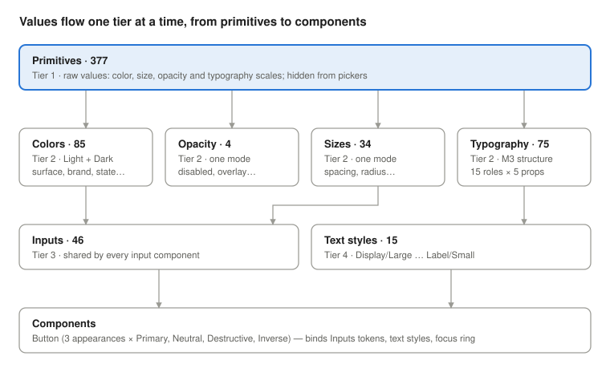

# Ingrid variable taxonomy

_Last updated: 23 October 2026_

The reference for how Ingrid's Figma variables are structured, named and changed. Every change to a variable should follow these rules.

## At a glance

Each tier aliases only the tier directly above it in this picture: semantic collections alias Primitives, Inputs aliases the semantic collections, and text styles bind Typography. Components bind Inputs tokens and text styles, plus the semantic focus-ring tokens shared by every component.

## Collections

Ingrid has 6 variable collections and 15 text styles, all in the Foundation Figma file. Each collection belongs to exactly one tier.

| Collection | Tier | Modes | Groups | Variables | Scopes |
| --- | --- | --- | --- | --- | --- |
| Primitives | 1 · Primitive | Value | `color`, `size`, `opacity`, `typography` | 377 | None (hidden from pickers) |
| Colors | 2 · Semantic | Light, Dark | `surface`, `surface/on-surface`, `primary`, `accent/1`, `accent/2`, `semantic/*`, `border`, `state`, `focus-ring` | 85 | Fills, strokes or text, per group |
| Opacity | 2 · Semantic | Value | `opacity` | 4 | Layer opacity |
| Sizes | 2 · Semantic | Value | `border`, `border-radius`, `spacing`, `dimension`, `focus-ring` | 34 | Stroke width, corner radius, gap, width/height |
| Typography | 2 · Semantic | Value | `display`, `headline`, `title`, `body`, `label` | 75 | Font family, size, line height, weight, letter spacing |
| Inputs | 3 · Category | Value | `color`, `size` | 46 | Per token |

Text styles are tier 4: 15 composite styles (`Display/Large` … `Label/Small`) whose five properties are bound to the Typography collection.

Only Colors has modes. Collections in tiers 3 and 4 still switch between Light and Dark, because their aliases resolve through Colors.

## Primitives

Primitives hold raw values only. They are never applied in designs directly; every semantic token aliases one of them.

| Group | Contents | Naming rule |
| --- | --- | --- |
| `color/<palette>/<step>` | 26 Tailwind v4 palettes (red … rose, slate … taupe), converted from OKLCH to sRGB hex | Steps 50, 100–900, 950; 500 is the base of each ramp |
| `color/brand/<step>` | The brand colour; replace this ramp to rebrand the system | Steps 50–900 (no 950) |
| `color/black`, `color/white`, `color/transparent` | Solid black and white; fully transparent white | Single values, no steps |
| `size/<step>` | One scale for every dimension: spacing, radius, border, font size, line height, icon and control size | Step = px × 25 (4px = `size/100`, 16px = `size/400`); `size/full` = 9999 for pills |
| `opacity/<n>` | 0 to 100 in steps of 5 | Name = the percentage |
| `typography/font-family/sans` | Source Sans Pro | — |
| `typography/font-weight/<name>` | 200 extralight … 900 black | Tailwind weight names |
| `typography/letter-spacing/<step>` | −0.8 … 1.6px | 500 = 0 (normal); lower is tighter, higher is wider |

Rules:

- **No transparency in colours.** Translucent colours are built at the semantic level from a solid colour plus an opacity primitive (see Colors). Don't add alpha colour ramps.
- **One size scale.** Font sizes, line heights, radii and border widths all alias `size/*`. Add a missing value as a new `size` step that follows the × 25 rule, never as a separate group.
- **Scale names carry the value.** For size and opacity, the step name can always be converted back to the value; keep it that way.
- **Scopes are always empty** so primitives never appear in Figma's pickers.

## Colors

Colors is the only collection with modes (Light and Dark). Every value in every mode is an alias to a colour primitive.

| Group | Palette | Tokens | Used for |
| --- | --- | --- | --- |
| `surface` | gray | default, subtle, muted, strong, inverse, disabled, overlay | Backgrounds of pages, containers and overlay components |
| `surface/on-surface` | neutral (brand for `brand`) | default, subtle, muted, disabled, inverse, brand | Text and icons on surface backgrounds |
| `primary` | brand | 6 shades + 2 on-colours | Primary actions |
| `accent/1` | indigo | 6 shades + 2 on-colours | Secondary emphasis |
| `accent/2` | rose | 6 shades + 2 on-colours | Tertiary emphasis, promotions |
| `semantic/error`, `warning`, `success`, `info` | red, amber, green, blue | 6 shades + 2 on-colours each | Status and feedback |
| `border` | neutral | subtle, default, strong, bold, disabled | Borders and dividers |
| `state`, `state/inverse` | black / white + opacity | hover, focus, selected, pressed (+ state/inverse/disabled, `state/disabled`) | Interaction overlays |
| `focus-ring` | blue | one token | The keyboard focus ring of every component |

### The 6-shade pattern

Every colour group (`primary`, `accent/*`, `semantic/*`) has the same six shades:

| Token | Light | Dark | Role |
| --- | --- | --- | --- |
| `default` | 500 | 500 | The main colour |
| `lighter` | 400 | 600 | Softer variant |
| `darker` | 600 | 400 | Stronger variant |
| `subtle` | 200 | 800 (brand: 700) | Faint tint: selected containers |
| `subtler` | 100 | 900 (brand: 800) | Fainter tint: banners, alerts, tags |
| `subtlest` | 50 | 950 (brand: 900) | Faintest tint: large tinted areas |

Dark-mode rules:

- The main colour stays 500 in both modes.
- `lighter` and `darker` swap 400 and 600, so the visual direction of hover and pressed is the same in both modes.
- The faint tints become dark tints, so they still read as subtle on a dark surface.

### On-colour pairing

Every background token has exactly one family of content tokens that may sit on it:

| Background | Text and icons on it |
| --- | --- |
| `surface/*` | `surface/on-surface/*` (only `surface/on-surface/inverse` on `surface/inverse`) |
| `<group>/default`, `lighter`, `darker` | `<group>/on-<group>`, e.g. `primary/on-primary` |
| `<group>/subtle`, `subtler`, `subtlest` | `<group>/on-<group>-subtle`, e.g. `primary/on-primary-subtle` |

`on-<group>` is white or `neutral/950`, whichever contrasts better with the group's 500. `on-<group>-subtle` is the group's 800 in Light and 200 in Dark.

### Translucent colours

A translucent colour is one variable whose value combines two aliases: a solid colour primitive and an opacity primitive. For example, `state/hover` is `color/black` + `opacity/5` in Light and `color/white` + `opacity/5` in Dark.

- **State overlays** (`hover`, `focus`, `selected`, `pressed`) sit on top of a component's background, whatever its colour. Use `state/inverse/*` on `surface/inverse`.
- **`state/disabled`** replaces a disabled component's background instead of overlaying it, and is the same for every component colour.
- **`surface/disabled`** is for large disabled areas such as a disabled input field.

**Every disabled element uses the same 25% transparency,** so a disabled element reads the same on any background: `state/disabled` and `surface/disabled` for backgrounds, `border/disabled` for borders, and `surface/on-surface/disabled` for text and icons are all black at 25% in Light and white at 25% in Dark. Layer dimming uses opacity/disabled, also 25%. Keep these in step: a change to one disabled value means changing all of them.

## Sizes, Opacity and Typography

These three semantic collections have one mode each. Every value aliases `size/*`, `opacity/*` or a `typography/*` primitive.

### Sizes

| Group | Tokens (px) | Scope |
| --- | --- | --- |
| `border` | none 0, default 1, strong 2, heavy 4 | Stroke width |
| `border-radius` | square 0, subtle 4, soft 8, rounded 16, extra-rounded 24, pill (full) | Corner radius |
| `spacing` | none 0, 4xs 1, 3xs 2, 2xs 4, xs 8, sm 12, md 16, lg 24, xl 32, 2xl 36, 3xl 40, 4xl 48 | Gap and padding |
| `dimension` | 2xs 12, xs 16, sm 20, md 24, lg 32, xl 36, 2xl 40, 3xl 44, 4xl 48, 5xl 56, 6xl 64 | Width and height |
| `focus-ring/width` | 2 | Stroke width |
| `focus-ring/offset` | 2 | None (Figma can't bind position); CSS outline-offset |

- **Spacing and dimension** use t-shirt sizes ordered from small to large.
- **Border radius** names describe the shape, not the component, so one radius can serve many components.

### Opacity

`transparent` 0, `disabled` 25, `overlay` 50, `opaque` 100. These are for layer opacity, for example dimming a whole disabled image or the backdrop behind a dialog. Translucent colours use opacity primitives directly (see Colors).

### Typography

The collection follows the Material 3 type-scale structure: 5 roles × 3 sizes = 15 combinations, each with font family, font size, line height, font weight and letter spacing (75 variables).

| Role | Large | Medium | Small | Weight | Used for |
| --- | --- | --- | --- | --- | --- |
| `display` | 48/56 | 40/48 | 32/40 | 400 | Short hero and marketing lines |
| `headline` | 28/36 | 24/32 | 20/28 | 600 | Page and section headings |
| `title` | 18/26 | 16/24 | 14/20 | 600 | Titles of cards, dialogs and list items |
| `body` | 16/24 | 14/20 | 12/18 | 400 | Running text |
| `label` | 16/20 | 14/16 | 12/16 | 600 | Text inside components: buttons, tabs, chips |

Values are font size / line height in px. Only the Material 3 structure is used; the values come from the size scale.

- Designers apply the text styles (`Display/Large` … `Label/Small`), never the typography variables one by one.
- A new text role or size means 5 new variables plus a new text style with all 5 properties bound.

## Inputs (category tier)

Inputs holds tokens shared by every input-type component: buttons, icon buttons, split and toggle buttons, text fields, selects, checkboxes and toggles. Its values alias semantic tokens, never primitives.

The collection has two top-level groups, by variable type: `color/` holds every colour variable (34) and `size/` every number variable (12). New Inputs variables go into the group that matches their type.

| Group | Tokens | Aliases |
| --- | --- | --- |
| `color/primary/filled` | background, label | `primary/default`, `primary/on-primary` |
| `color/primary/outlined` | border, label | `primary/default`, `surface/on-surface/brand` |
| `color/primary/text` | label | `surface/on-surface/brand` |
| `color/neutral/filled` | background, label | `surface/inverse`, `surface/on-surface/inverse` |
| `color/neutral/outlined` | border, label | `surface/inverse`, `surface/on-surface/default` |
| `color/neutral/text` | label | `surface/on-surface/default` |
| `color/destructive/filled` | background, label | `semantic/error/default`, `semantic/error/on-error` |
| `color/destructive/outlined` | border, label | `semantic/error/default`, `semantic/error/darker` |
| `color/destructive/text` | label | `semantic/error/darker` |
| `color/inverse/filled` | background, label | `surface/default`, `surface/on-surface/default` |
| `color/inverse/outlined` | border, label | `surface/on-surface/inverse` (both) |
| `color/inverse/text` | label | `surface/on-surface/inverse` |
| `color/state` | hover, focus, pressed | `state/*` |
| `color/state/inverse` | hover, focus, pressed | `state/inverse/*` (inputs on dark backgrounds: filled neutral, outlined and text inverse) |
| `color/disabled` | background, border, label | `state/disabled`, `border/disabled`, `surface/on-surface/disabled` |
| `color/inverse/disabled` | background, border, label | `state/inverse/disabled` |
| `size` | border-radius, border-width | `border-radius/subtle`, `border/default` |
| `size/small`, `size/medium`, `size/large` | height, padding-x, gap, icon-size | `dimension/*` and `spacing/*` (24/32/44 high) |

Colour tokens follow `color/<variant>/<appearance>/<part>`: variant is the colour (primary, neutral, destructive, inverse), appearance is the emphasis (filled, outlined, text), part is what it colours (background, border, label).

**Inverse inputs are only for dark backgrounds** (`surface/inverse`, which is light in Dark mode). Their colours, state overlays and disabled colours are all mirrored for that background. On normal surfaces, use Primary or Neutral.

Rules:

- **No component-level tokens.** Names describe the role inside any input (`color/primary/filled/background`, `size/medium/height`), never a single component (`button/…`).
- **New categories get new collections.** When another family of components needs shared tokens (for example navigation or containers), create a collection for that category rather than adding to Inputs.
- **Label and icon are separate roles.** The `…/label` tokens colour label text; icons use them for now. If icons need their own shade, add `…/icon` tokens next to them.
- **Focus ring is not here.** It's the same for every component, so it lives at the semantic level: `focus-ring` in Colors and `focus-ring/width` in Sizes. Components draw it on its own absolutely positioned layer, focus-ring/offset (2px) outside their edge, so the ring never replaces the component's own border.

## Naming, CSS, scopes and descriptions

Every variable must pass all four rules below.

### 1. Naming

- Lowercase, slash-separated groups, hyphens inside words: `surface/on-surface/subtle`.
- Primitives are named by value (`size/400`, `opacity/40`, `color/blue/500`).
- Semantic and category tokens are named by role (`primary/default`, `spacing/md`, `border-radius/soft`), never by value or component.
- Scales go from small to large: numeric steps for primitives, t-shirt sizes (`4xs` … `6xl`) or ordered words (`subtle` → `bold`) for semantic tokens.

### 2. CSS code syntax

Every variable has a WEB code syntax in the form `var(--ingrid-<name>)`, where `<name>` is the Figma name with slashes replaced by hyphens.

| Collection | Pattern | Example |
| --- | --- | --- |
| Primitives | `--ingrid-<name>` | `color/blue/500` → `var(--ingrid-color-blue-500)` |
| Colors | `--ingrid-color-<name>`, `semantic/` dropped | `semantic/error/default` → `var(--ingrid-color-error-default)` |
| Opacity, Sizes, Typography | `--ingrid-<name>` | `spacing/md` → `var(--ingrid-spacing-md)` |
| Inputs | `--ingrid-input-<name>`, `color/` and `size/` dropped | `size/medium/height` → `var(--ingrid-input-medium-height)` |

Every CSS name must be unique across all collections.

### 3. Scopes

| Kind of token | Scopes |
| --- | --- |
| Primitives | none |
| Backgrounds (`surface`, `state`, fills) | Frame fill, shape fill |
| Colour groups (`primary`, `accent`, `semantic`) | All fills, stroke colour |
| Text and icon colours (`on-*`, `…/label`) | Text fill, shape fill |
| Border colours, focus ring | Stroke colour |
| `border`, `focus-ring/width`, `border-width` | Stroke width |
| `border-radius` | Corner radius |
| `spacing`, padding, gap | Gap |
| `dimension`, height, icon size | Width/height |
| `opacity` | Layer opacity |
| Typography | The matching font property |

Never use "All scopes".

### 4. Descriptions

Every semantic and category token has a description that says where to use it and what it pairs with, for example: `primary/on-primary` — "Text and icons placed only on primary/default, primary/lighter or primary/darker backgrounds." Primitives all carry the same line: don't apply directly; reference a semantic token.

## Changing variables

Use the matching checklist for every change.

### Adding a token

1. Pick the lowest tier that needs it. A raw value goes in Primitives; a role goes in a semantic collection; something shared by a family of components goes in its category collection.
2. Alias one tier down only: semantic → Primitives, category → semantic. Never put a raw value above the primitive tier.
3. Name it by role (or by value, for primitives) following the naming rules, and place it in the existing group order.
4. Set its scopes, its `--ingrid-` CSS code syntax and its description.
5. In Colors, set both Light and Dark. Follow the dark-mode rules for colour groups.
6. Check that its CSS name is unique.

### Changing a value

1. Change the alias, not the raw value, unless you are editing a primitive.
2. Changing a primitive affects every token that aliases it. Check its dependents first.
3. For colours, re-check the contrast of every on-colour pair that uses it.

### Renaming

1. Rename in place: the variable ID stays the same, so bindings in components and styles keep working.
2. Update the CSS code syntax to the new name.
3. Update every description that mentions the old name.
4. Developers: treat the old CSS name as a breaking change.

### Deleting

1. Check that no variable aliases it and no component or style is bound to it.
2. Repoint dependents to their replacement first, then delete.
3. Remove the name from any description that mentions it.

## Known exceptions and open decisions

Known exceptions to the rules above:

- **Typography primitives' CSS names omit the group.** `typography/font-weight/semibold` is `--ingrid-font-weight-semibold`, not `--ingrid-typography-font-weight-semibold` (15 variables).
- **Border width CSS names differ from the Figma group.** `border/default` in Sizes is `--ingrid-border-width-default` (4 variables).
- **The brand ramp has no 950,** so its faint tints in Dark mode use 700/800/900 instead of 800/900/950.
- **Error is built on 600, not 500.** semantic/error/default is red/600 in both modes, lighter is 500/700 and darker is 700/500 (Light/Dark), and on-error is white. White on red/600 is 4.77:1; white on red/500 would only be 3.81:1. White on error/lighter (Light) and error/darker (Dark) is 3.81:1, so use those two for fills without text.
- **The brand ramp is out of order at 300/400:** `brand/300` (#a9d354) is darker than `brand/400` (#a4df2b).
- **focus-ring/offset has no scopes.** Figma can't bind a variable to a layer's position, so the token exists for code (outline-offset) and as the documented gap; component focus-ring layers are placed 2px outside by hand.

Open decisions:

- [ ] Contrast on brand green: white text on `brand/500` is 2.3:1, so `primary/on-primary` is near-black. Text buttons use `brand/700` on white (about 3.3:1, under the 4.5:1 minimum).
- [ ] Whether to keep `color/transparent` or express transparency only through opacity primitives.
- [ ] Whether to add a backdrop (scrim) token for dialogs now that `surface/overlay` is a solid surface.
- [ ] Whether buttons need a colour option (accent, error) beyond primary.
